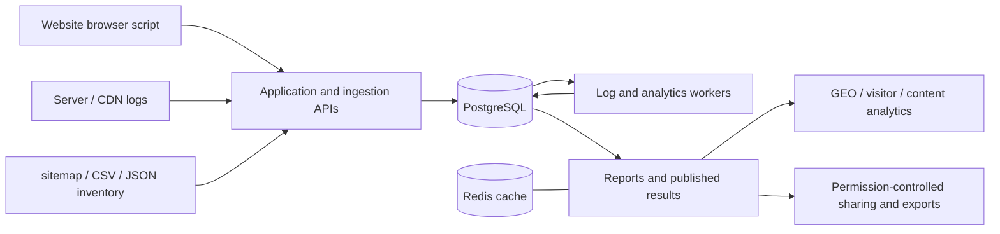

# GEOInflow

[English](README.md) | [简体中文](README.zh-CN.md) | **日本語**

生成エンジン最適化（GEO）のための、セルフホスト型のウェブ・AI クローラー分析システムです。

**共同発行：猎看科技 · 北京日报社智源GEO**

[クイックスタート](docs/getting-started.en.md) · [デプロイ](docs/deployment.en.md) · [AI クローラー分析](docs/ai-crawler-analytics.md) · [アーキテクチャ](docs/system-overview.md) · [ドキュメント](docs/README.md) · [コントリビュート](CONTRIBUTING.md)

GEOInflow は、ウェブサイトの訪問者、AI 検索からの流入、サーバーのクロールログ、コンテンツのインベントリを、共通のウェブサイトのコンテキストにまとめます。どの AI クローラーがサイトを訪れているか、どのページをリクエストしているか、どの重要なページでクロール活動が観測されていないか、どこでリクエストが失敗しているか、そして AI 検索が訪問者とコンバージョンにどう貢献しているかを、チームが把握できるようにします。

このシステムには、ブラウザトラッキング、アカウント権限、GEO レポート、クローラーの証跡、ログ収集、分析の高速化が含まれています。現在のプロダクトバージョンは **v1.2**、ビルドバージョンは **1.2.0** です。アプリケーションのソースコードは [MIT license](LICENSE) の下で配布されています。

クイックスタートとデプロイのガイドは、英語と簡体字中国語で提供されています。リンク先のその他のリファレンスガイドは、現在は簡体字中国語のみです。

## 紹介動画

https://github.com/user-attachments/assets/81e57cc4-3441-4e5f-b2fb-cd929c6c27bd

## 何に使えるか

| 問い | 利用できるデータ | 判断に役立つアクション |
| --- | --- | --- |
| どの AI プラットフォームがサイトを訪れているか？ | クローラーの識別情報、目的、提供元、リクエスト量、検証ステータス、トレンド | 学習、検索、ユーザー起点のリクエストを区別し、コンテンツがどのようにアクセスされているかを把握する |
| どのページが繰り返しクロールされているか？ | ページのランキング、繰り返しのリクエスト、ディレクトリの分布、最近のアクティビティ | 頻繁にリクエストされるパス、無効な URL、コンテンツの構造を見直す |
| 重要なページはクロールされているか？ | sitemap / CSV / JSON のインベントリをインポートし、観測されたログと比較 | 入口、内部リンク、robots のルール、レスポンスを確認する |
| クローラーのリクエストは成功しているか？ | HTTP ステータス、GET / HEAD、キャッシュ、レイテンシ、エラー、リスクシグナル | ブロックされたリクエスト、オリジンのエラー、カバレッジの低下、ソースの中断を調査する |
| AI 検索はサイトに何をもたらしているか？ | AI からの流入セッション、ランディングページ、ゴール、コンバージョン | 実際のトラフィックとビジネス成果の変化を観察する |
| 結論を出すのに十分な証拠があるか？ | 識別の証拠、ソースのカバレッジ、欠落、入力の不足、推定値 | 同じデータ範囲で結果を見直し、証拠の欠落を明示しておく |

GEOInflow は、企業サイト、コンテンツサイト、メディア、開発者向けドキュメント、そして複数のサイトを管理する GEO チーム向けに設計されています。運用担当者はウェブサイト単位・ページ単位で作業でき、メンテナーはインジェスト、キュー、ソースの品質、計算方法を確認できます。

## AI クローラー分析

### クローラーの識別情報と目的

組み込みのカタログは、OpenAI、Anthropic、Perplexity、Google、Microsoft、ByteDance、Baidu、Kimi、Tencent Hunyuan などの提供元をカバーしています。従来の検索クローラーやその他のボットの観測データも保持します。

カタログは、プラットフォーム、プロダクト、リクエストの識別情報を別々に記録します。学習、AI 検索、ユーザー起点のアクセスはリクエストの目的を表し、AI ワークベンチやパーソナルエージェントはプロダクトの種類を表します。これらの次元は重なることがあります。有効なエントリは、管理者が公開したカタログと各ウェブサイトの設定によって決まります。

申告された User-Agent 文字列、公式 IP レンジとの照合結果、利用可能な DNS または信頼できるエッジの証拠は、それぞれ独立して保存されます。User-Agent の申告だけでは、ソースを確認するのに不十分です。検証の証拠がない過去のレコードは、不明のステータスのまま保持されます。

### クロール活動とコンテンツのカバレッジ

リクエストされたページのランキング、観測されたページ、繰り返しのリクエスト、ディレクトリの分布、主要なクローラー、最近のアクティビティ、コンテンツの鮮度を確認できます。コンテンツのインベントリをインポートすると、既知のページ群に対して、観測されたクロールのカバレッジと AI の死角を測定できます。

識別情報、目的、プロダクトの種類によるフィルターは、集計とページネーションの前に適用されます。カード、表、比較、エクスポートはすべて同じ条件を使用します。パスの観測結果と推定による結果には、推定値であることを示すラベルが付いたままになります。

### 証拠をもとにアクセスの問題を調査する

HTTP レスポンス、キャッシュ、レイテンシ、レスポンスのバイト数、収集の継続性、リスクの検出結果は、それぞれ別々に表示されます。チームは対応状況、メモ、保留、再開を記録し、該当する時間帯と証拠を見直すことができます。

アクセスポリシーは、robots / Nginx の設定のエクスポートに対応しています。対応している Cloudflare の制御には、個別の Zone の認証情報、プレビュー、明示的な確認、バックグラウンドでの実行、そしてリモートの状態の読み戻しが必要です。提供元のプラン、権限、利用可能なフィールドは、デプロイした環境で確認する必要があります。

### AI からの流入とビジネス成果

ブラウザトラッキングは、対応している AI 検索からの流入を認識し、ランディングページ、イベント、ゴール、コンバージョンと組み合わせます。クローラーのリクエスト、流入セッション、コンバージョンは別々に測定されます。ソースをまたいだ関連付けには、比較可能性の限界が残ります。

**クロールログで確かめられるのは、観測されたアクセスです。インデックス登録、モデルの学習、回答での引用、レコメンドの順位、顧客獲得には、それぞれ独自の証拠が必要です。**

指標、ワークフロー、制限事項については、[AI クローラー分析ガイド](docs/ai-crawler-analytics.md)を参照してください。

## ウェブサイト分析

| 機能 | 範囲 |
| --- | --- |
| ページビューと訪問者 | PV、UV、訪問、流入元、地域、デバイス、ブラウザ、コンテンツのパフォーマンス |
| イベントとコンバージョン | カスタムイベント、ゴール、ファネル、訪問者の経路、アトリビューション、収益分析 |
| 拡張分析 | 検索エンジン、流入キーワード、UTM、パフォーマンス、ヒートマップ、リテンション、オーディエンス |
| コラボレーション | ウェブサイト、個人スペースとチームスペース、権限、ワークスペース、ダッシュボード、一般公開での共有 |
| エクスポート | 選択した範囲の CSV / JSON / ZIP。フィールド、状態、機密データの扱いを保持 |
| AI アシスタンス | ウェブサイトの事実に基づく、オプションのモデル接続と会話。デフォルトでは無効 |
| 運用とガバナンス | インジェストのチェック、過去データの修復、分析の高速化、ソースとルールのバージョン管理 |

アプリケーションは簡体字中国語と英語に対応しています。主な期間は Today / 7 日間 / 30 日間で、分析のデフォルトのタイムゾーンは `Asia/Shanghai` です。初回の本サインイン時に国と都市のタイムゾーンを確認し、以降のリクエストではアカウントに保存されたタイムゾーンで「今日」を定義します。リアルタイムの訪問者は直近 30 分間を対象とし、リテンションは暦月を使用します。

ブラウザの指標は、共通のトラフィック品質ポリシーを共有しています。データなし、連携の未設定、不明な値、推定値、未対応の機能は、それぞれ別の状態として表示されます。デモ用のウェブサイトには明示的にラベルが付きます。機能の一覧は[ページのカバレッジ](docs/ui-coverage.md)を、日付の定義は[期間とタイムゾーン](docs/date-ranges.md)を参照してください。

## データがシステムに入る仕組み



ブラウザスクリプトは、ページビュー、イベント、有効にした拡張データを収集します。サーバーと CDN のログは、ブラウザスクリプトを実行しないクローラーのリクエストを補います。コンテンツのインベントリは、既知のページ群を提供します。各入力は個別に接続でき、ソースが欠けている場合は、対応する分析がその制限を明示します。

ログの処理では、ソース、分類、検証の証拠が保持されます。分析ワーカーは、事前集計、正確な訪問の事実データ、永続化された結果を使って、計算の繰り返しを減らします。標準のダッシュボードと負荷の高い分析には、別々の受け入れ制御があります。よく使われる期間は事前にウォームアップされ、バックグラウンドでの更新中も公開済みの結果は引き続き利用できます。[アーキテクチャガイド](docs/system-overview.md)を参照してください。

## クイックデプロイ

Docker Engine / Docker Desktop と Docker Compose V2 を起動し、イメージと依存関係のダウンロード元にアクセスできることを確認してください。ソースコードを取得したら、プロジェクトのルートで次のコマンドを実行します：

```sh
sh scripts/liekan-deploy.sh
```

このスクリプトは、非公開の `.env` とランダムなシークレットを生成し、アプリケーションのイメージをビルドし、マイグレーションを実行し、新規インストールの場合は同梱の公式サンプルをインポートしてから、アプリケーション、ログワーカー、分析ワーカー、PostgreSQL、Redis を起動します。デフォルトのアドレスは次のとおりです：

```text
http://127.0.0.1:3002
```

新規インストールの場合、初期ユーザー名は `admin`、初期パスワードは `liekan` です。サインイン後にパスワードを変更し、インジェストのガイドに従ってウェブサイトを作成してください。アップグレード時には、既存のカスタマイズしたパスワードとアカウントは保持されます。

Docker の起動時には、マイグレーションの後に、匿名化済みの完全な公式サンプルがインポートされます。手動で開発する場合は、次を実行してください：

```sh
docker compose -f docker-compose.liekan.yml exec app node scripts/liekan-seed-demo.mjs
```

このサンプルの名前は「猎看官网（示例数据）」です。ソースと Docker イメージには、匿名化済みの完全なデータセット、カタログ、チェックサムのマニフェストが含まれており、ブラウザのイベント、パフォーマンス、収益、ヒートマップ、リプレイ、クローラーの証跡、コンテンツ、ゴールをカバーしています。初回のインポート時には、データを探索しやすいようにタイムスタンプがずらされます。繰り返し実行しても、既存のデータと削除の状態は保持されます。[デフォルトのデモのガイド](docs/default-demo.md)を参照してください。

本番環境での利用には、ドメイン、HTTPS、信頼できるリバースプロキシが必要です。信頼できる IP のイングレスがなくても、ブラウザからの生の受信は観測できます。PV や UV を含む、品質基準を満たしたブラウザの指標には、利用可能な識別の証拠が必要です。ログの自動インジェストとオプションの AI 分析には、それぞれ個別の設定要件があります。

[デプロイガイド](docs/deployment.en.md)では、サービス、設定、プロキシ、バックアップ、アップグレードについて説明しています。[クイックスタート](docs/getting-started.en.md)では、最初のウェブサイトを接続する方法を説明しています。

## 分析を最新の状態に保つ

Today のメインダッシュボードは、30 秒ごとに公開済みの結果を読み込み、実際のデータの締め時刻を表示します。ページが非表示のときやオフラインのときは、読み込みが一時停止します。リアルタイムの訪問者は独自の更新間隔を使用し、ヒートマップやリテンションなどの負荷の高い分析は、より長いバックグラウンドの時間枠を使用します。

完了した結果は、ブラウザ、プロセス、Redis、PostgreSQL に永続化されます。よく使われる期間とページは、クエリの条件を共有します。容量の保護機能が古い時間枠の削除を管理し、アイドル状態の失敗したタスクは自動リトライを一時停止し、初回の計算は永続的なバックグラウンドタスクで完了させることができます。更新時には、統計の権限と、ソースの品質、日付、ルールのバージョンのチェックが維持されます。

初回の計算、キャッシュヒット、バックグラウンドでの更新は、それぞれコストが異なります。実際のパフォーマンスは、データ量、カバレッジの構築、データベース、キャッシュの状態によって決まります。デプロイ後は、分析の高速化のページでタスクとカバレッジを確認できます。[分析の高速化](docs/analytics-acceleration.md)と[キャッシュ](docs/analytics-cache.md)を参照してください。

## セルフホスティングと対象範囲

- ウェブサイト分析の中核機能とクローラーの識別は、モデルの API キーなしで、自前のインフラ上で実行できます。
- ブラウザトラッキングは、デフォルトで Cookie を使用しません。オプションの記録、イベントのプロパティ、ビジネス連携は、デプロイごとに設定したデータ範囲を使用します。
- AI 分析はデフォルトで無効です。有効にした場合、ユーザーがモデルの接続とウェブサイトの資料を選択します。モデルに送信されるデータについては、[AI 設定ガイド](docs/ai.md)を参照してください。
- GEO Weight はベータ版です。直近 30 日間の完全な暦日における、品質基準を満たした AI のコンテンツアクセスを使用し、計算式、証拠、制限事項を文書化しています。[ウェイトのガイド](docs/geo-weight.md)で、固定のポリシーと適用範囲を定義しています。
- GEO の拡張機能、補足的なジャーニー、完全なエクスポート、分析の高速化は、主に PostgreSQL を対象としています。残されている ClickHouse、リンク、ピクセルのエンドポイントは既存のプロトコルに従います。各 GEO 拡張機能への対応は、個別に確認する必要があります。
- サーバーからの自動収集には、公開 HTTPS、インジェスト用のシークレット、署名付きのインストール用アセットが必要です。Cloudflare との連携には、さらに OAuth、権限、該当する提供元の機能も必要です。
- 検索の表示回数、実際の順位、モデルの回答での引用、学習への取り込み、記事の読了率には、追加のデータが必要です。詳細なガイドでは、このプロジェクトが提供する観測値とスコアを定義しています。

## 開発とメンテナンス

開発には Node.js **22.23.4**、pnpm **12.3.4**、PostgreSQL を使用します。[デプロイガイド](docs/deployment.en.md)に従って独立したデータベースと非公開の設定を用意し、次のコマンドを実行してください。この例では、開発用に別のポート `3302` を使用しています：

```sh
pnpm install --frozen-lockfile
pnpm build:db
pnpm db:migrate
pnpm liekan:migrate
pnpm liekan:queue-bootstrap
pnpm build:openapi
pnpm build:packages
pnpm build:tracker
pnpm build:recorder
pnpm liekan:build-worker
pnpm dev --port 3302
```

[CONTRIBUTING.md](CONTRIBUTING.md) の説明に従って、ログワーカーと分析ワーカーを別々のターミナルで起動してください。開発用のワーカーとウェブアプリケーションは、同じ非公開の環境設定を使用します。

プロダクトのページは `src/components/liekan`、データの契約は `src/lib/liekan/contracts`、アップストリームのクエリと権限のアダプターは `src/lib/liekan/upstream` にあります。新しい構造には、プロジェクトの差分マイグレーションを使用します。適用済みのマイグレーションは変更されません。`liekan` の技術的な識別子、収集のプロトコル、既存のワークスペースのパッケージ名は、互換性を維持しています。

Issue の報告、コントリビュート、範囲を絞った検証、アップストリームとの同期については、[コントリビュート](CONTRIBUTING.md)、[ドキュメントの目次](docs/README.md)、[アップストリームのメンテナンス](docs/upstream-upgrade.md)を参照してください。

## ライセンスと告知

GEOInflow のアプリケーションのソースコードとプロジェクトのドキュメントは [MIT license](LICENSE) を使用しており、その告知の要件に従うことを条件に、商用利用を含む使用、改変、再配布が許可されています。これらの許可は、ライセンスの全文に従います。

GEOInflow は、猎看科技と北京日报社智源GEO が共同で発行しています。元の著作権表示とライセンスの文面は、ソースとともに保持されています。プロジェクトの由来と互換性の関係については、[アップストリームに関するメモ](docs/upstream.md)を参照してください。

依存関係、フォント、地理データセットは、それぞれ独自のライセンスを維持しています。[サードパーティの告知](THIRD_PARTY_NOTICES.md)を参照してください。デフォルトの地理データセットは DB-IP City Lite で、その帰属表示と CC BY 4.0 ライセンスが保持されています。提供された MaxMind やその他の地理データベースは、それぞれのデータの利用条件に従う必要があります。ランタイムの設定、実際の訪問者データ、データベースのバックアップ、秘密鍵、非公開で提供された地理データベースは、ソースのリリースには含まれません。
